I am documenting my System on Chip FPGA VGA Driver project here. I started with a template that draws vertical colour bars and reworked it, one change at a time, until it became my own design of full-screen diagonal colour stripes on a Basys3 board.

## **Template VGA Design**
### **Project Set-Up**
I used Xilinx Vivado to design the project for a Digilent Basys3 board with an Artix-7 FPGA. I imported the Verilog design files and testbench from Moodle and used a constraints file to assign the design's ports to the board's pins. I then went through the standard procedure of testing the design with the testbench, synthesising it, implementing it and generating the bitstream. I also programmed the board and observed the output on a monitor.

### **Template Code**
A VGA monitor produces the image by scanning out each pixel one at a time across each row from left to right, and down the screen from top to bottom. It uses two sync signals to determine its position. For a 640x480 display at 60Hz, a pixel clock of approximately 25 MHz is needed. There are 800 pixel clocks per line, 640 of which are visible pixels followed by a horizontal front porch, HSYNC pulse, and horizontal back porch. There are 525 lines per frame, 480 of which are visible lines followed by a vertical front porch, VSYNC pulse, and vertical back porch ([VGA 640x480 timing](http://tinyvga.com/vga-timing/640x480@60Hz)). During the porch and sync times, the colour outputs must be black.

The template is broken into two parts: the timing part and the colour part. The timing part uses counters to track the current column col and row. It generates the HSYNC and VSYNC pulses at the correct counts, and also determines when the col and row counters are in the 640x480 visible area. The colour part is an always @* block which functions as the next-state/output logic. It checks the current col value against a series of ranges, and then sets the red_next, green_next and blue_next values accordingly. Each range is 80 pixels wide, and therefore 8 ranges x 80 = 640 pixels, and the display will show eight vertical colour bars.

Each colour channel is 4 bits wide, so the Basys3's VGA output can produce 16 levels per channel, or 4,096 colours in total (12-bit RGB) ([Basys3 Reference Manual](https://digilent.com/reference/programmable-logic/basys-3/reference-manual)).

### **Simulation**
First, the design is simulated in Vivado using the provided testbench. The testbench creates the clock and reset and allows the design to run, so the waveform window can be used to verify that the HSYNC and VSYNC signals toggle at appropriate intervals, and that the RGB outputs change at the column boundaries and are zero while blanking. Since a full frame is 800 x 525 = 420,000 pixel clocks in length, it is more practical to zoom into a single line than to observe an entire frame.

### **Synthesis**
Synthesis takes the Verilog code and translates it into a netlist comprised of FPGA primitives, like look-up tables and flip-flops. In the implementation step, the FPGA primitives are mapped onto the Artix-7 and the connections between them are routed. The constraints file is used to map the design to the correct pins on the FPGA. When implementation finishes, Vivado will create a bitstream which can be downloaded to the board via the Hardware Manager.

### **Demonstration**
When I first programmed the Basys3, the vertical colour bars from the template could be seen on the screen. This meant that the timing as well as the design flow were correct and I was ready to make changes to the template.

## **My VGA Design Edit**
I wanted to implement **diagonal stripes of different colours, covering the whole screen**, starting from the template's vertical colour bars. I worked in small steps and tested each change on the Basys3 to see how it affected the image:

1. Change the colours of the existing bars.
2. Turn the vertical bars into horizontal bars.
3. Turn the bars diagonal.
4. Fix the diagonal version so that the stripes cover the whole screen.

This seemed achievable because each step only changes the colour logic. The VGA timing part of the template stays the same throughout.

### **Code Adaptation**

#### Step 1: Changing the colours
I left the "if / else if" structure of the template exactly as it was and only changed the 4-bit RGB values in each range, using different combinations of 0s and 1s. This showed me how each 4-bit value controls the strength of one colour channel.

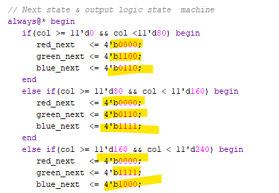
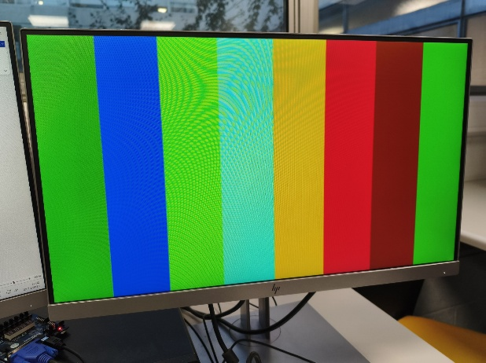

#### Step 2: Vertical to horizontal
Next I tried to rotate the bars. I didn't change the structure; I only replaced col with row in every condition. The colour now depends on which line is being drawn instead of which pixel along the line, so the bars become horizontal. The screen is only 480 lines tall, so with 80-line bands only 6 of the 8 colours fit (480 / 80 = 6), which can be seen in the photo.

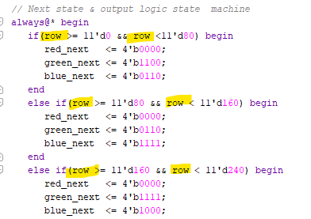
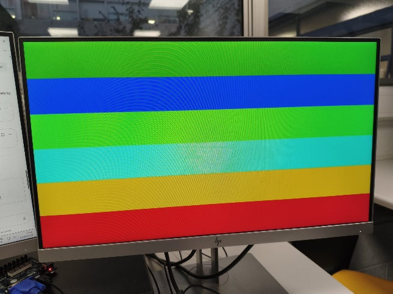

#### Step 3: Making the lines diagonal (16/11/2026)
To make the bars diagonal, the colour has to depend on both row and col. I replaced the condition with row + col. Every pixel where row + col gives the same total lies on the same diagonal line, so for example:

| row | col | row + col |
|-----|-----|-----------|
| 20 | 60 | 80 |
| 40 | 40 | 80 |
| 60 | 20 | 80 |

So each if condition now selects a diagonal band instead of a vertical one.

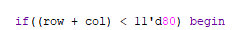

Rows count downwards from the top of the screen, so as col increases (moving right), row must decrease (moving up) to keep the same total. This means row + col produces lines in the "/" direction. To get the opposite direction, the difference e.g. col - row would be used instead.

Each band uses the same style of condition (`< 80`, `< 160`, `< 240`, ...), which produced the diagonal stripes below:

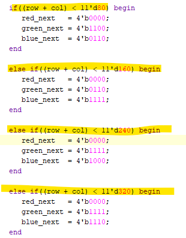
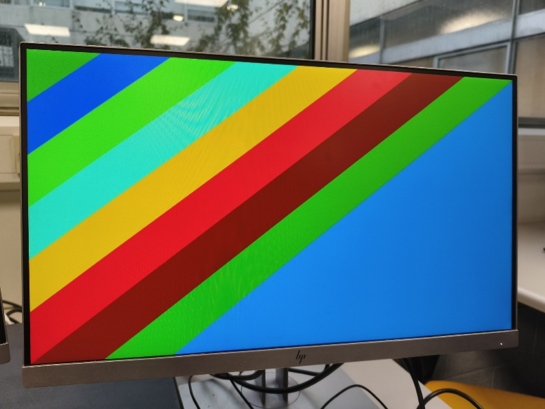

#### Problem: one colour filling a third of the screen
The result was not what I intended. I wanted every diagonal line to be a different colour, but roughly the lower-right third of the screen was a single shade of blue. I hadn't thought through the range of values that `row + col` can take. The largest value on the visible screen is 479 + 639 = 1118, but my bands were still 80 wide and only went up to 640 (8 x 80). Any pixel where `row + col` was 640 or more fell through to the final `else` and got the same colour.

#### Step 4: The fix
First, I added a 12-bit diagonal wire above the always @* block that holds the sum of row and col. Each value is zero-extended to 12 bits before adding, which leaves an extra bit of headroom for the sum. Calculating it once in a wire also makes the conditions shorter and easier to read.

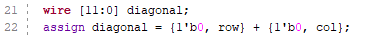

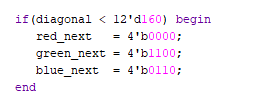

Then I changed every condition to use diagonal and doubled the width of each band from 80 to 160 (< 160, < 320, < 480, ...). Seven bands of 160 cover 0-1119, which is the full range of row + col (0-1118) so the stripes now stretch across the entire screen. Each stripe is also twice as wide. The final colour only starts after the last band, so it never appears on the visible screen and only the first 7 colours are shown.

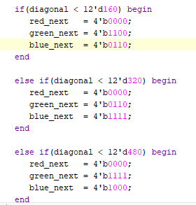

### **Simulation**
My design uses the same ports and timing as the template, so the supplied testbench can be reused. The thing to check in simulation is that the RGB outputs now change as row + col crosses each multiple of 160, instead of only at the column boundaries. On a single line the colour change therefore happens at a different column on each row, moving one pixel to the left for every row further down the screen.

### **Synthesis**
The synthesis and implementation flow is the same as for the template. The main difference in the design is the extra 12-bit adder for diagonal and the comparisons against wider constants.

### **Demonstration**
The final design running on the Basys3: diagonal stripes, each a different colour that fills the whole 640x480 screen.

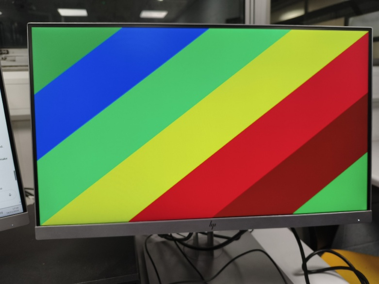

## **Reflection**
Choosing to work in small steps meant that each change had one clear effect on the screen, which made it easy to connect the Verilog to the image. The biggest lesson came from the bug in Step 3. The code was valid, but I hadn't thought about the range of values the new expression could take. Working out the maximum of row + col explained the problem straight away and led directly to the fix. As a next step, I would like to add a frame counter so that the stripes scroll across the screen, or combine row + col and col - row to make a pattern of diamonds.

## **References**
- [VGA Signal 640 x 480 @ 60 Hz timing, TinyVGA](http://tinyvga.com/vga-timing/640x480@60Hz)
- [Basys 3 Reference Manual, Digilent](https://digilent.com/reference/programmable-logic/basys-3/reference-manual)
- M. Lynch, *FPGA VGA Driver Project* brief and template code, System on Chip Design & Verification, ATU Galway.
